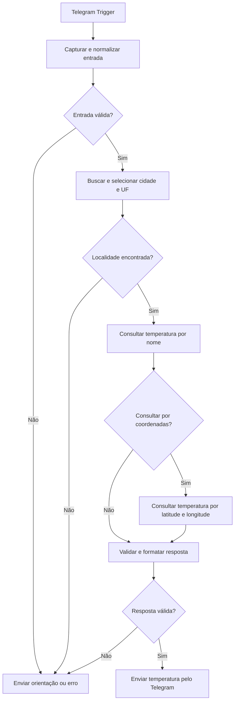

# ClimaBot — bot de clima no Telegram

Chatbot desenvolvido com n8n para consultar a temperatura atual de cidades brasileiras pelo Telegram. O projeto integra Telegram e OpenWeather, valida cidade e UF e devolve uma mensagem curta em português.

**Entrada**

```text
São Paulo,SP,BR
```

**Exemplo de resposta**

```text
🌤️ A temperatura em São Paulo é de 22°C.
```

A temperatura é obtida no momento da consulta. O valor acima foi observado durante a validação e não é uma resposta fixa.

## Funcionalidades

- Recebimento de mensagens pelo Telegram Trigger.
- Normalização de acentos, letras maiúsculas e espaços excedentes.
- Validação do formato `Cidade,UF,BR`, da UF e do país.
- Localização da cidade com a API de geocodificação da OpenWeather.
- Consulta da temperatura em Celsius, com idioma `pt_br`.
- Consulta alternativa por coordenadas quando a busca textual retorna uma localização incompatível.
- Mensagens de orientação para entrada inválida, cidade não encontrada e falhas do serviço.
- Resposta enviada ao mesmo chat que iniciou a solicitação.

A saída é determinística. Gemini e outros modelos de linguagem não são utilizados.

## Arquivos do projeto

| Arquivo | Finalidade |
|---|---|
| `workflow-chatbot-telegram.json` | Workflow exportado da instância n8n testada, sem credenciais e inativo para importação |
| `docker-compose.yml` | Serviços n8n, executor externo e gateway de webhooks |
| `.env.example` | Modelo de configuração sem valores secretos |
| `infra/nginx-webhooks.conf` | Regras de acesso aos webhooks |
| `tests/workflow.test.cjs` | Verificações locais da lógica contida no JSON |
| `tests/openweather.integration.cjs` | Consultas reais à OpenWeather, sem enviar mensagens Telegram |
| `docs/GUIA-EXECUCAO.md` | Passo a passo detalhado |
| `docs/TESTES.md` | Resultados e limites das evidências de validação |

## Arquitetura



Cada etapa tem uma responsabilidade visível no fluxo: receber, validar, consultar, formatar e responder. Os três nós Code tratam apenas os dados; os nós Set, IF, HTTP Request e Telegram fazem a integração e o roteamento.

O Set captura `chatId`, `rawText` e `queue`. O `chatId` é preservado nas consultas para que a resposta retorne ao remetente correto. As demais variáveis usam camelCase e nomes ligados ao domínio, como `cityName`, `stateCode`, `locationFound` e `responseValid`.

### Localização e temperatura

A variável `queue` é mantida por exigência do desafio. Na OpenWeather, o parâmetro de pesquisa reconhecido é `q`.

A geocodificação retorna até cinco candidatos. O fluxo filtra nome, estado, país e coordenadas válidas. Quando existem homônimos, prioriza uma correspondência única no nome localizado em português, `local_names.pt`. Se a seleção continuar ambígua, retorna erro.

A consulta principal usa o endpoint público de clima atual:

```text
https://api.openweathermap.org/data/2.5/weather
```

| Parâmetro | Configuração |
|---|---|
| `q` | `={{ $json.queue }}` |
| `units` | `metric` |
| `lang` | `pt_br` |
| `appid` | `={{ $env.OPENWEATHER_API_KEY }}` |

Se a consulta textual retornar 404 ou país/coordenadas incompatíveis, outro HTTP Request consulta o mesmo serviço usando somente `lat` e `lon`, além de `units`, `lang` e `appid`. O fluxo não depende da precedência de `q` sobre coordenadas na mesma requisição.

Antes do envio, a resposta precisa conter HTTP 200, `cod=200`, nome, temperatura numérica finita, país BR e coordenadas a até 0,02 grau da localidade escolhida. A temperatura é arredondada com `Math.round`.

## Infraestrutura

| Componente | Configuração |
|---|---|
| n8n | `2.44.5` |
| Executor externo dos nós Code | `n8nio/runners:2.44.5` |
| Gateway de webhooks | `nginx:1.28-alpine` |
| Persistência | SQLite interno do n8n em volume Docker exclusivo |
| Rede | Bridge exclusiva do projeto `climabot-telegram` |
| Editor local | `http://localhost:5682` |
| Gateway local para o túnel | `http://localhost:5684` |

O executor não recebe a chave OpenWeather nem monta o volume de credenciais. Sua comunicação com o n8n ocorre pela rede Docker, sem portas publicadas no Windows.

O ngrok fornece o HTTPS exigido pelo Telegram e aponta para o gateway. O gateway permite POSTs em `/webhook/` e `/webhook-test/`; editor e API administrativa ficam bloqueados nesse acesso público. A rota `/healthz` do gateway responde apenas à verificação de saúde.

## Pré-requisitos

- Telegram e um bot criado pelo `@BotFather`.
- Conta OpenWeather com chave habilitada.
- Docker Desktop com Docker Compose.
- ngrok instalado e autenticado na sua conta.
- Node.js 24 ou superior para gerar os segredos internos e executar as verificações locais.

O Node.js do computador não é necessário para executar o bot depois de configurado: n8n e executor rodam nos contêineres.

## Configuração

### 1. Preparar o arquivo privado

Na pasta do projeto, copie o modelo somente se ainda não existir um `.env`:

```powershell
if (-not (Test-Path -LiteralPath '.env')) {
    Copy-Item -LiteralPath '.env.example' -Destination '.env'
}
```

Edite o `.env` localmente e preencha:

| Variável | Uso |
|---|---|
| `OPENWEATHER_API_KEY` | Chave OpenWeather usada pelos nós HTTP via expressão de ambiente |
| `TELEGRAM_BOT_TOKEN` | Referência privada do token; cadastrar também na credencial Telegram API do n8n |
| `N8N_ENCRYPTION_KEY` | Chave persistente para criptografar as credenciais do n8n |
| `N8N_RUNNERS_AUTH_TOKEN` | Segredo de comunicação entre n8n e executor |
| `WEBHOOK_URL` | HTTPS fornecido pelo ngrok, com barra final |

Para cada um dos dois segredos internos, gere um valor diferente:

```powershell
node -e "console.log(require('node:crypto').randomBytes(32).toString('hex'))"
```

Execute o comando uma vez para `N8N_ENCRYPTION_KEY` e outra para `N8N_RUNNERS_AUTH_TOKEN`. Preserve os valores se o ambiente já estiver configurado. A chave de criptografia deve permanecer a mesma entre reinicializações.

O endereço `https://example.invalid/` do modelo é provisório: permite iniciar o editor local, mas não recebe mensagens do Telegram.

### 2. Iniciar os serviços

```powershell
docker compose up -d --wait
docker compose ps
```

Acesse [localhost:5682](http://localhost:5682) e cadastre o proprietário da instância.

### 3. Configurar o HTTPS

Em outro terminal:

```powershell
ngrok http http://localhost:5684 --inspect=false
```

Copie o HTTPS informado pelo ngrok para `WEBHOOK_URL` no `.env`, incluindo a barra final. Mantenha esse endereço na configuração privada.

Aplique a mudança:

```powershell
docker compose up -d --wait
```

O Compose repassa o valor para `N8N_WEBHOOK_URL`, nome utilizado pela versão instalada do n8n. Mantenha Docker e túnel em execução enquanto o bot estiver em uso.

### 4. Importar o workflow

1. No n8n, abra o menu do workflow e selecione **Import from File**.
2. Escolha **`workflow-chatbot-telegram.json`**.
3. Confira os nós e as conexões e salve.

O arquivo distribuído está inativo e sem referências a credenciais. A configuração precisa ser feita na instância de destino.

### 5. Cadastrar a credencial Telegram

1. Abra o nó **Receber mensagem**.
2. Crie uma credencial do tipo **Telegram API**.
3. Insira o token fornecido pelo BotFather e salve.
4. Selecione essa mesma credencial nos três nós:
   - **Receber mensagem**
   - **Enviar temperatura**
   - **Enviar orientação ou erro**

A variável `TELEGRAM_BOT_TOKEN` não cria a credencial automaticamente. O token utilizado pelos nós fica armazenado, de forma criptografada, no cofre do n8n.

A OpenWeather usa a expressão `={{ $env.OPENWEATHER_API_KEY }}`. Não substitua essa expressão por uma chave literal no workflow.

### 6. Executar

Para um teste pontual, clique em **Execute workflow** e envie uma cidade ao bot. A escuta manual pode encerrar após o evento; inicie outra execução para testar a próxima mensagem.

Para receber mensagens continuamente, encerre a escuta manual e publique o workflow. O Telegram mantém um único webhook por bot: modo de teste e versão publicada substituem o endereço um do outro.

## Validação

Os quatro cenários abaixo foram confirmados manualmente e estão visíveis na captura do Telegram fornecida durante a validação de 21/10/2026.

| Mensagem | Resultado observado |
|---|---|
| `São Paulo,SP,BR` | Temperatura de 22°C |
| `Belo Horizonte,MG,BR` | Temperatura de 27°C |
| `Florianópolis,SC,BR` | Temperatura de 21°C |
| `CidadeInexistenteXYZ,SP,BR` | Mensagem de cidade não encontrada |

Os valores correspondem ao momento do teste. A imagem original contém outras conversas e não integra os arquivos para publicação. O [relatório de testes](docs/TESTES.md) registra a evidência e seus limites.

Entrada inválida, cidade não encontrada ou payload inválido em HTTP 200 recebem:

```text
❌ Cidade não encontrada. Use o formato Cidade,UF,BR (ex.: São Paulo,SP,BR).
```

Falhas técnicas, como autenticação, limite de requisições ou timeout, recebem:

```text
⚠️ O serviço de clima está indisponível no momento. Tente novamente em alguns minutos.
```

### Verificações executáveis

```powershell
node tests/workflow.test.cjs
```

As **49 verificações locais** executam a lógica do próprio JSON com dados simulados e conferem normalização, validação, homônimos, fallback, erros, temperatura, parâmetros e conexões.

Para testar a OpenWeather com a chave local, sem enviar mensagens Telegram:

```powershell
node tests/openweather.integration.cjs
```

Esse comando faz chamadas reais à API e atualiza [RESULTADOS-API.json](docs/RESULTADOS-API.json) com os resultados, sem registrar a chave.

## Segurança dos arquivos de entrega

O repositório contém nomes de variáveis e endereços públicos da documentação dos serviços. **Chaves de API, tokens, segredos internos e o endereço real do túnel não fazem parte da entrega.**

- `.env`, logs, arquivos ZIP e evidências privadas são ignorados pelo Git.
- `.env.example` contém apenas os campos esperados, sem segredos.
- O JSON exportado não contém credenciais, tokens, dados de chat ou dados fixados em `pinData`.
- O acesso a variáveis de ambiente está habilitado para atender ao desafio; a instância deve permanecer restrita a editores confiáveis.
- O editor e a API administrativa não são encaminhados pelo túnel público.
- As execuções de produção não persistem payloads; a configuração mantém limpeza de registros com idade máxima de 24 horas.

Antes de publicar qualquer novo export, revise também dados fixados, nomes/IDs privados de credenciais e capturas de tela. O volume do n8n e o arquivo `.env` devem permanecer locais.

## Operação

```powershell
docker compose ps
docker compose stop
docker compose up -d --wait
```

O volume conserva usuário, workflows e credenciais. `docker compose down` remove os contêineres e a rede do projeto, preservando o volume; a opção `-v` remove também os dados persistidos.

Se o endereço ngrok mudar, atualize `WEBHOOK_URL`, recrie o serviço com `docker compose up -d --wait` e registre novamente o webhook pela publicação do workflow. Para encerrar o túnel iniciado em terminal, use `Ctrl+C`.

## Limites e decisões

- A busca geográfica retorna até cinco candidatos. Uma cidade ausente dos resultados ou ainda ambígua recebe erro; não há garantia de cobertura irrestrita de todos os municípios.
- A seleção por estado é feita sobre a geocodificação. A consulta textual da OpenWeather não garante filtro por UF brasileira.
- As consultas HTTP têm timeout de 15 segundos e até duas tentativas quando ocorre uma exceção. Status como 401 e 429 seguem para tratamento sem repetição automática.
- O envio Telegram não tem retry automático. Não há deduplicação persistente por `update_id`; uma reentrega do evento pode gerar outra resposta.
- `queue` é o nome exigido para a variável interna; `q` é o parâmetro HTTP reconhecido pela OpenWeather.
- O arquivo segue o nome `workflow-chatbot-telegram.json`, indicado na seção de entrega do desafio.

## Entrega

Os arquivos obrigatórios são **`workflow-chatbot-telegram.json`** e **`README.md`**. O Compose, a configuração do gateway, os testes e a documentação complementam a reprodução do ambiente.

O JSON final foi exportado da instância Docker usada nos testes. Para distribuição, foram removidas as referências privadas a credenciais e os metadados da instância; `active` está como `false` e `pinData` está vazio.

A entrega na plataforma utiliza o endereço de um repositório público. Publique somente os arquivos revisados e confirme o acesso ao README e ao JSON sem autenticação.

## Documentação complementar

- [Guia de execução do zero](docs/GUIA-EXECUCAO.md)
- [Infraestrutura e isolamento](docs/INFRAESTRUTURA.md)
- [Resultados dos testes](docs/TESTES.md)
- [Checklist de entrega](docs/CHECKLIST-ENTREGA.md)
- [Roteiro de apresentação](docs/ROTEIRO-APRESENTACAO.md)

## Referências

- [OpenWeather — clima atual](https://openweathermap.org/api/current)
- [OpenWeather — geocodificação](https://openweathermap.org/api/geocoding-api)
- [n8n — Telegram Trigger](https://docs.n8n.io/integrations/builtin/trigger-nodes/n8n-nodes-base.telegramtrigger/)
- [n8n — executores externos dos nós Code](https://docs.n8n.io/hosting/configuration/task-runners/)
